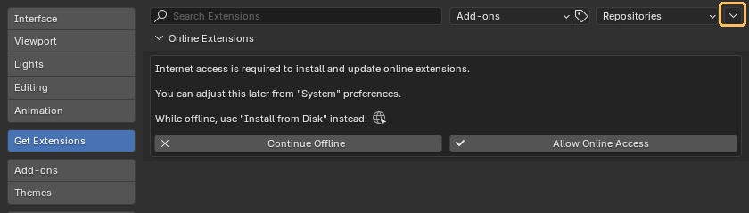
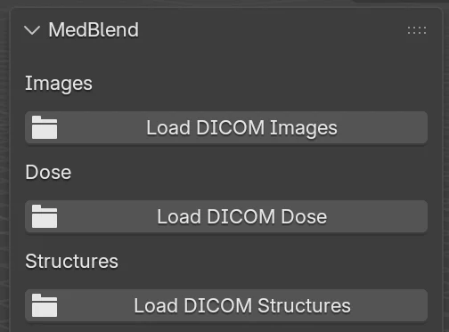
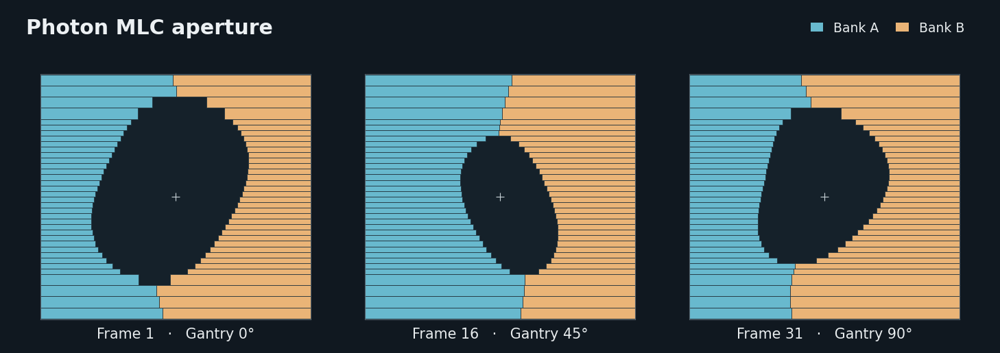
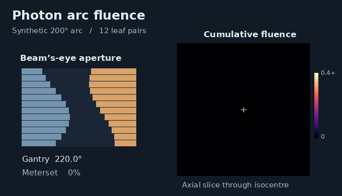

# MedBlend

A medical visualisation extension for Blender.

> MedBlend is under active development and is intended for research, education, and scientific communication.


## Intended use

MedBlend imports DICOM images, radiotherapy dose, structure sets, and photon and proton plans into Blender to create visualisations for research, education, presentations, and publications.

## Disclaimer

MedBlend is not a medical device and must not be used for diagnosis, treatment planning, treatment delivery, or other clinical decisions. The software is provided without warranty.

## Data handling and privacy

MedBlend processes DICOM files locally and makes no network requests. It reads files selected by the user and writes generated VDB volume files to a folder beside the saved .blend file, to Blender's temporary directory while the scene is unsaved, or to a directory selected in the extension preferences.

DICOM data may contain identifying health information. MedBlend does not deliberately copy patient names or patient IDs into Blender, but imported voxel data, ROI and beam names, and technical DICOM identifiers can remain in generated VDB files or the saved `.blend` file. De-identify source data and review exported files before sharing them.

## Requirements

MedBlend requires Blender 5.0 or newer. It is tested against Blender 5.x, including Blender 5.2 LTS.

The extension package includes the `pydicom` wheel declared in `blender_manifest.toml`. Blender installs this dependency into the extension's managed Python environment. NumPy and OpenVDB are supplied by supported Blender builds.

## Installation

Use **Blender 5.0 or newer**. For photon MLC animation, choose **MedBlend 2.1.0 or newer**. Cumulative photon fluence is available in **2.2.0**. The 2.0.0 package includes the proton importer. Blender installs the bundled Python dependency when you install the extension.

### Get the extension ZIP

| Where you are installing from | Which file to use |
| --- | --- |
| A published release | Open [MedBlend Releases](https://github.com/drmichaeldouglass/MedBlend/releases), expand **Assets** for the version you want, and download the file named `medblend-<version>.zip`. Leave that ZIP intact for Blender. |
| The photon-plan pull request | Sign in to GitHub and open the [successful photon build](https://github.com/drmichaeldouglass/MedBlend/actions/runs/44378863678). Under **Artifacts**, download **medblend-extension**. Unzip that outer download once to get **`medblend-2.1.0.zip`**. This inner ZIP is the file Blender installs. |

GitHub Actions artifacts expire. If the build download has expired, check the release assets for 2.1.0 or newer, or download the [photon-plan source](https://github.com/drmichaeldouglass/MedBlend/tree/feature/photon-plan-mlc) and follow the [build instructions](#development).

### Install in Blender

1. Open **Edit → Preferences → Get Extensions**.
2. Click the small **⌄** at the far right of the top row, beside **Repositories**, and choose **Install from Disk…**.
3. Select the extension ZIP and confirm. Under **Preferences → Add-ons**, search for **MedBlend** and check that it is enabled.
4. Close Preferences. Move the pointer over the **3D Viewport**, press **N** to open its sidebar, then select the vertical **Medical** tab. You can also reach the DICOM importers through **File → Import**. Look for **DICOM RT Plan (photon MLC and jaws)** or **DICOM RT Ion Plan (proton spots)** there.



*The highlighted dropdown contains Install from Disk. Screenshot cropped and annotated from the [Blender 5.2 Manual](https://docs.blender.org/manual/en/5.2/editors/preferences/extensions.html), [CC BY-SA 4.0](https://creativecommons.org/licenses/by-sa/4.0/).*

## How to use MedBlend

### Import a patient study

1. Save your Blender scene, for example as `study.blend`.
2. In the **Medical** sidebar, choose **Load DICOM Images** and select **one slice** from the planning CT or MR series. MedBlend finds the other slices with the same series UID in that directory. For CT, try **CT-Bone** in the file dialog’s **Preset** dropdown. You can change the [volume rendering preset](#volume-rendering-presets) later.
3. Add the corresponding structures, dose or plan with the buttons below. For a structure set, place the RTSTRUCT file beside its referenced image slices so MedBlend can use their voxel grid. For a photon plan, importing the matching CT first lets the beam rig follow the CT when you move, rotate or scale it.



| Medical sidebar button | Select in the file browser | What appears in Blender |
| --- | --- | --- |
| **Load DICOM Images** | One CT or MR slice | A volume containing the image series. |
| **Load DICOM Structures** | RT Structure Set (RTSTRUCT) | A separate volume for each imported ROI, coloured from the structure set. |
| **Load DICOM Dose** | RT Dose (RTDOSE) | A dose volume. The object’s custom properties record its maximum dose and the DICOM dose units. |
| **Load Photon Plan** | Conventional photon RT Plan (RTPLAN) | A collection for each imported beam, containing animated MLC leaves and jaws. [View the playback example](#play-a-photon-plan). |
| **Load Proton Plan** | Scanned proton RT Ion Plan | Spot spheres grouped by beam geometry. The sphere radius represents relative spot weight, with a common scale across the plan. |

### Play a photon plan

1. Choose **Load Photon Plan** and open the RT Plan file. In the **Outliner**, expand **Photon Plan …** and a beam collection to see its MLC leaves and jaws. With a matching CT already loaded, the rig is registered to the CT. A standalone import uses DICOM patient coordinates in metres.
2. Drag the **Timeline** playhead or click **Play**. Beams appear in file order. Within each beam, the leaf tips, isocentre, gantry, collimator and couch follow the planned control points. To see the opening clearly, look along the beam axis towards isocentre.
3. To inspect a specific control point, select the **beam collection** in the Outliner and open **Collection Properties → Custom Properties**. The entries in `medblend_control_point_frames` are the Blender frame numbers for control points 0, 1, 2 and so on. Enter one in the Timeline’s current-frame field to jump there.



*Three control points from a synthetic plan imported in Blender 5.2. Each view follows the collimator. Blue and amber identify the banks for this illustration. The dark opening is the aperture.*

**Geometry and timing.** MLCX and MLCY leaf widths come from adjacent DICOM leaf boundaries. The rectangular leaves have schematic outer lengths and flat tips. When both source-axis and source-to-device distances are available, MedBlend scales the aperture to the device plane. A missing device distance triggers a notice with the assumed distance. A missing source-axis distance places the aperture at isocentre. Motion interpolates linearly between control points, including zero-meterset transitions. Timeline spacing is for visual playback.

**Supported setups.** Photon import supports head-first and feet-first supine, prone and decubitus setups. A missing patient position defaults to HFS with a notice. MedBlend skips beams that use enhanced beam limiting devices, gantry pitch, table pitch or roll, eccentric rotation or dynamic table translations, and reports the reason.

### Animate cumulative photon fluence

1. Save the scene and import the matching CT if you want to see the projection around the patient.
2. Choose **Medical → Load Photon Plan**, enable **Animate Cumulative Fluence** in the file browser options, and select the RTPLAN. MedBlend bakes a **Cumulative Photon Fluence** collection alongside the animated beam rig.
3. Switch to **Rendered** viewport shading and scrub the timeline. The first frame starts empty. As the leaves and gantry move, each exposed voxel accumulates fluence in patient coordinates. The last frame holds the sum for the imported photon beams in one fraction.



*The colour scale stays fixed throughout this synthetic arc. The cross marks isocentre. The image on the right is one axial slice from the calculated 3D grid.*

**Fluence Voxel Size (mm)** sets spatial resolution. Start with the 6 mm preview, then reduce the spacing to resolve smaller openings. **Maximum Fluence Frames** sets how many cumulative states are displayed across the timeline, including the empty first state. More states give smoother playback and write more VDB files. The integration samples aperture motion between displayed states. Keep the VDB files with the scene as described below.

Each voxel contains **relative incident fluence** from an ideal point source, projected between the downstream aperture plane and the instantaneous isocentre plane. The model intersects MLC leaf openings and jaws, applies inverse-square scaling relative to the isocentre plane and weights each interval by its change in cumulative meterset. Zero-meterset motion adds zero fluence. An always-open isocentre accumulates 1.0 over a fully exposed plan. The model omits attenuation, scatter, leaf transmission, head fluence profiles and dose deposition.

A multi-beam sum requires beam metersets from a single fraction group. A single beam can use its own normalised control-point weights. If the required geometry or weights are unavailable, the importer keeps the aperture animation and reports why it skipped the volume. The beam rig’s reported assumptions about missing device distances also apply to the projection.

### Inspect a proton plan

Choose **Load Proton Plan** and open the RT Ion Plan file. Static energy layers with the same geometry share an object. Stepped or arc segments with different geometry appear as separate objects. Select a spot object and adjust **Spot Size** in its Geometry Nodes modifier to make the pattern easier to see. At the default scale, the heaviest spot in the plan has a radius of 1.3 mm. The [proton phantom example](#example-imports) shows the spots together with CT and dose.

The proton importer assumes head-first supine orientation and warns about other positions. It skips non-proton ion beams. If geometry changes during an irradiation segment, the spots are displayed at that segment’s starting geometry and MedBlend reports a warning.

### Save and move the scene

CT, dose and ROI volumes read their voxel data from external VDB files. With the default settings, saving `study.blend` keeps those files in **`study_vdb/`** beside the scene. If you imported into an unsaved scene, MedBlend copies the temporary VDBs there on the first save. **Move or share the folder together with the .blend file.**

If you choose a **VDB Temp Directory** in the Medical sidebar or extension preferences, MedBlend writes the volumes there instead. Keep that directory accessible when reopening the scene. Each import creates uniquely named files.

## Adjust CT and dose materials

MedBlend assigns a material during import. To inspect a CT or dose volume, select it in the **Outliner**, then open **Material Properties**. A default CT import uses **Image Material**, a CT imported with a preset uses that preset’s material, and an RT Dose import uses **Dose Material**.


Open the **Shading** workspace with the volume selected to edit its shader nodes. For the default materials, adjust the intensity window to isolate the values you want to display, or edit the colour ramp to change their appearance. Use **Rendered** viewport shading to inspect the result.


DICOM CT is stored in Hounsfield units, which typically run from about -1000 (air) through 0 (water) to well beyond 1000 (bone). **MedBlend imports those values unchanged**: a voxel in the VDB grid reads the same number as the DICOM file, so -1000 is air and 400 is bone in every scene, whatever else is in the scan. The range a particular series covers is recorded on the imported object as the custom properties `medblend_intensity_min` and `medblend_intensity_max` (visible in `Object Properties > Custom Properties`), along with `medblend_modality`.

Normalising is left to the shader, which is the only place that needs it. The Image Material's node group takes `Min HU` and `Max HU` inputs, and MedBlend fills them in with the range of the volume it is applied to, so a fresh import renders without hand-tuning. Narrow them to isolate a tissue: `-1000` to `-400` for lung, `-100` to `100` for soft tissue, `200` to `1500` for bone. Because the numbers are Hounsfield units rather than a fraction of one particular scan's range, the same window means the same thing on the next patient.

Each window gets its own copy of the material (`Image Material - -1024 to 3071`), so retuning one volume never rewindows another that is already in the scene.

Imported dose volumes are likewise unscaled: their voxels hold absolute dose, and the maximum value and dose units are recorded on the object as `medblend_dose_max` and `medblend_dose_units`. The Dose Material's `Min Dose` and `Max Dose` inputs are set to `0` and that maximum on a per-range copy (`Dose Material - 0 to 70.2`), so the colour ramp spans the dose actually present. Raise `Min Dose` to hide low-dose regions. The asset leaves `Intensity` at `0`, which emits no light, so the copy is given `5` unless you have already set your own value on the Dose Material.


## Volume rendering presets

MedBlend ships the 31 volume rendering presets from [3D Slicer](https://www.slicer.org) - `CT-Bone`, `CT-Lung`, `CT-Cardiac`, `MR-Default`, `MR-T2-Brain`, `uCT-Skull` and the rest - as ready-made Blender volume materials. Each one is Slicer's own colour transfer function and scalar opacity function rebuilt as colour ramps in a Principled Volume shader, so a freshly imported CT or MR looks like the equivalent view in Slicer without hand-tuning a shader.

Apply one either way:

- **At import.** Pick a preset in the `Preset` dropdown of the Load DICOM Images file dialog. Leaving it on `Default Image Material` keeps the previous behaviour.
- **Afterwards.** Select one or more imported volumes, choose a preset under `Image Volume Presets` in the Medical sidebar, and press `Apply Preset`.

Three settings control how the preset lands:

- **Scalar Range** decides how the preset's scalar values map onto your data. Slicer's `CT-` presets are keyed to Hounsfield units, which are calibrated, so on a CT a preset scalar is read against the voxel value that equals it - no conversion in between. Everything else - MR, ultrasound, micro-CT - is stored in per-scan intensities with no fixed meaning, so the preset's authored window is stretched across whatever range the volume occupies. `Auto` picks between the two for you; `Hounsfield Units` and `Fit To Data` force one.
- **Density** is the extinction of a fully opaque voxel, in 1/m. Raise it for a more solid volume, lower it to see further inside. Blender volumes are imported in metres, so this is what converts Slicer's per-sample opacity into something Blender can integrate.
- **Emission** is how brightly the volume glows on its own. The default of `1.0` means a preset reads immediately without adding a light; drop it towards zero to light the volume with scene lights and let the preset's colours act as scattering albedo instead.

Applying the same preset with the same settings reuses one material, so pushing a preset onto several volumes - or re-applying it after an edit - does not fill the file with copies. Different settings get their own material rather than changing one that another volume is already using.

### Editing a preset material

Open the Shading tab with the volume selected and you get a small, editable node tree:

- **Window** (a Map Range node) maps voxel values onto the `0 - 1` the colour ramps behind it are addressed by, and is the equivalent of Slicer's shift slider. `From Min`/`From Max` are in the volume's own units - Hounsfield units for a CT - so narrowing them squeezes the whole preset into a tighter part of the intensity range.
- **Color Transfer** and **Scalar Opacity** are the two transfer functions as colour ramps. Drag the stops to retune the preset; the opacity ramp carries its value in the alpha channel, which is what the shader reads.
- **Density Scale** is the multiply node that turns opacity into Blender density.

The material also records what it was built from as custom properties (`medblend_preset`, `medblend_preset_window`, `medblend_preset_data_range`, and Slicer's `medblend_slicer_ambient`/`_diffuse`/`_specular`/`_specular_power`/`_shade`), visible in `Material Properties > Custom Properties`.

### What is and is not carried over

Colours are converted from Slicer's sRGB display values into Blender's scene-linear colour space, so hues match rather than rendering washed out. Two parts of a Slicer preset have no Blender equivalent and are not applied: the gradient opacity functions, because shader nodes cannot read a volume's gradient magnitude, and the Phong shading parameters, because Blender's volume shader is physically based - those are recorded on the material for reference instead.

The presets are reproduced from Slicer under its BSD-style licence; see [THIRD_PARTY_NOTICES.md](THIRD_PARTY_NOTICES.md). To refresh them from a newer Slicer release, run `python "development scripts/generate_preset_data.py"`.

## Converting CT volumes into a mesh

Rather than viewing the DICOM data as a volume, it is possible to convert the CT data into a mesh. This can be performed by apply the volume to mesh modifier in Blender. 

Start by creating a place-holder object. From the add menu, add a cube into the scene. This cube object will hold the volume to mesh modifier. 


With the cube selected, go to the modifier menu, select Add Modifier and add a Volume to Mesh modifier.


From the object property, select the CT volume, then adjust the threshold to isolate the tissue you want. The threshold is in Hounsfield units, the same as the voxels: around `300` is a good starting point for bone in a typical CT, `-500` picks up the lung-air boundary, and `0` sits at water. The `medblend_intensity_min`/`medblend_intensity_max` custom properties on the volume tell you what range that particular scan actually covers.


This is what the mesh should look like at a threshold that isolates bone. You can apply this modifier from the Volume to Mesh modifier panel to bake the mesh which will allow for manual adjustments.


## Example imports

A CT scan, structures and dose volumes imported and overlayed. 


DICOM structures for a test prostate radiotherapy plan showing organs at risk such as prostate, urethra, bladder, rectum and the external structure.


A test proton therapy plan on a phantom. The CT images, dose distribution and proton spots are shown.


## Development

Install the dependencies for the unit tests and run them outside Blender:

```bash
python -m pip install -r requirements-dev.txt
python -m pytest
```

To build an installable ZIP from source, open a terminal in the directory containing `blender_manifest.toml`. Create a folder named `dist` there, then run the following with Blender 5.0 or newer on your command path.

```bash
blender --command extension validate .
blender --command extension build --source-dir . --output-dir dist
blender --command extension validate dist/medblend-2.2.0.zip
```

Upload the archive produced by `extension build` to the Blender Extensions platform. Do not upload the repository or GitHub's generated source archive. GitHub Actions runs the unit tests and builds and validates the extension package for every push and pull request.

## Known Issues
- Not tested on MRI, SPECT, PET or other imaging modalities.
- CT/MR series and RT Dose grids must have uniform slice/plane spacing. MedBlend
  rejects non-uniform or duplicate positions because a single OpenVDB volume
  cannot preserve them without resampling.
- CT/MR stacks with sideways displacement between slice origins (shear, as in
  some gantry-tilted acquisitions) must be resampled onto an orthogonal grid
  before image or structure import. MedBlend rejects these stacks to prevent
  distorted anatomy. Oblique stacks without shear remain supported.
- Contours are rasterised using an even-odd point-in-polygon test sampled at voxel centres, so a structure boundary is resolved to the nearest voxel. Small structures relative to the CT voxel size will show that quantisation.
- Imported CT, dose, structure, and proton spot objects are now all placed in the DICOM patient coordinate system (millimetres mapped to metres), so they co-register automatically regardless of import order. Note that the CT volume is therefore no longer centred at the world origin. If you move, rotate or scale the CT before importing dose, structures or a proton plan with the same Frame of Reference, those imports are placed relative to the CT where it now sits. Objects already in the scene are not moved with it, so parent them to the CT if you want them to follow later moves.
- Proton beam orientation (gantry and couch rotation) follows the plan's patient position for head-first and feet-first supine, prone and decubitus setups, the same as photon plans. Any other patient position is placed as head-first supine (HFS) and a warning is shown.
- Gantry pitch and table-top pitch/roll are not yet applied to proton spot geometry.
- If the bundled dependency is missing from the installed package, MedBlend will fail to load. Reinstall using the official extension archive and ensure the `wheels/` directory is included.

Please report bugs through [GitHub Issues](https://github.com/drmichaeldouglass/MedBlend/issues).

## Future Updates

### Import Brachytherapy Dwell Points

Visualise brachytherapy dwell point positions and dwell times

### Treatment simulation with Linac model.


## License

MedBlend is released under the [GNU General Public License v3.0 or later](LICENSE). The bundled `pydicom` wheel remains under its upstream licence; see [Third-party notices](THIRD_PARTY_NOTICES.md).

## How to cite

MedBlend: A Medical Visualisation Add-On for Blender, M.Douglass
https://github.com/drmichaeldouglass/MedBlend

DOI: 10.5281/zenodo.10633327

## References
